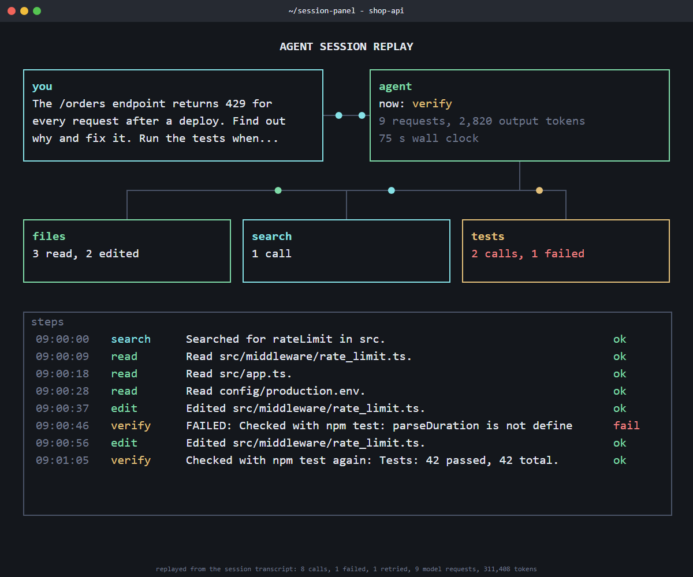

<div align="center">

# session-panel

**Replay a Claude Code session as an animated terminal panel you can post or watch in any browser.**

agentplay showed what an agent session did; live-panel made architecture diagrams that look alive. session-panel turns one session transcript into one self-contained 10 KB page: the prompt, the agent, the tools it used, and every step scrolling by with its result.

Works with **Claude Code** and **Codex**.

 

</div>

## Quick start
```bash
git clone https://github.com/Dodai0419/session-panel && cd session-panel
python session_panel.py fixtures/session.jsonl      # or: python session_panel.py --latest
```
```
8 calls, 1 failed, 1 retried, 9 requests, 311,408 tokens
wrote session-panel.html
```
Open `session-panel.html`: one step every 1.5 s (`--period`), packets flow to the tool boxes, failures show in red, and the replay loops. `?t=10` opens at second 10; `?manual` stops the loop.



## The problem
- "What did the agent actually do?" has no quick, visual answer; the transcript is thousands of JSONL lines.
- Session viewers are local web apps; you cannot drop them into a PR comment, a post or a slide.
- Animated diagram tools want a hand-written config and Chrome + ffmpeg for video.

## The solution
| Idea | Fixes |
|------|-------|
| **agentplay's session counts** (calls, failures, retries, model requests, tokens) | The same totals as `agentplay export`, from the raw transcript |
| **Session becomes a live-panel config**: prompt box, agent box, one box per tool kind, a `cycle` machine with one value per step | No config to write; the failing step is red |
| **Compact live-panel renderer** (text, box, line, flow, log; counter, lane and cycle machines) | One 10 KB HTML file, no server, no build; renders upstream's `minimal` example too |

Render any live-panel config in the supported subset: `python session_panel.py --config fixtures/minimal.json --out minimal.html`.

## Use with Claude Code
```bash
/plugin marketplace add Dodai0419/session-panel
/plugin install session-panel@session-panel
```

## Use with Codex (ChatGPT)
```bash
git clone https://github.com/Dodai0419/session-panel && cp -r session-panel/skills/* ~/.codex/skills/
```
Or copy `AGENTS.md` into your project root.

## Benchmarks
| | original | this repo |
|-|-|-|
| session totals on `fixtures/session.jsonl` (calls, errors, retries, requests, tokens, output tokens, duration, user turns) | agentplay 0.2.1: 8, 1, 1, 9, 311,408, 2,820, 75 s, 1 | same 8 values (unit test) |
| the same totals on 14 finished real Claude Code sessions on the test machine | agentplay 0.2.1 `export` | calls, errors, requests, tokens, output tokens, user turns: 14/14 identical; retries: 9/14 (off by 1 to 3) |
| session to shareable output, CLI wall time | 2.24 s (`agentplay build --rebuild`; runs: 2.39, 2.23, 2.11; a map for its local viewer) | 1.03 s (parse + page; runs: 1.08, 0.96, 1.05) |
| page build + write, live-panel `examples/minimal/config.json` | 11.8 ms (`livepanel.build_page`, median of 5 rounds of 50) | 2.5 ms (median of 5 rounds of 50) |
| page size, same config | 148,756 bytes | 8,988 bytes |
| lines of code | agentplay 21,242 (Python) + live-panel 630 (livepanel.py + template.html), plus 2,082 in views/*.js | 310 |
| dependencies | stdlib (+ Chrome and ffmpeg for live-panel mp4) | stdlib |

Windows 11, Python 3.11.1, tools run in turn for three rounds; bare `python -c pass` takes about 0.7 s here, most of this repo's wall time. agentplay builds a far richer map (cost in USD, file map, subagents, PRs, a viewer); session-panel keeps what a replay needs. Steps are evenly spaced in the replay; the log clock is scaled to the session's real duration.

Not supported yet: live-panel's `loop`/`ring`/`funnel` views, `path`, `tarrow`, `gauge`/`triggers` machines, light-pastel theme, mp4 export. Subagent (sidechain) steps are skipped.

## Inspired by
- [Entelligence-AI/agentplay](https://github.com/Entelligence-AI/agentplay) — what to count in a Claude Code session and how (Apache-2.0).
- [ythx-101/live-panel-skill](https://github.com/ythx-101/live-panel-skill) — the JSON config format, `cycle` machine and terminal-dark look (MIT).

## Roadmap
- [ ] Codex session files
- [ ] Optional mp4 export through headless Chrome
- [ ] `--redact` to hide paths and commands before sharing

## License
MIT. See LICENSE and NOTICE.
